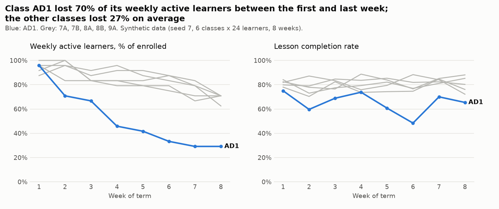
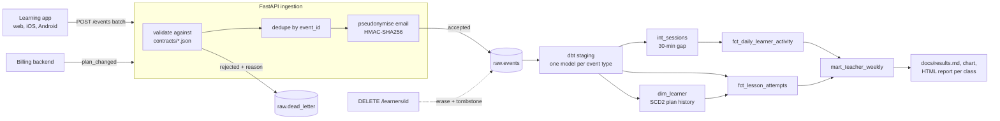

# Learning Events Platform: data contracts, dbt and teacher reports for an EdTech app


An event-data platform for an online learning app, like the ones I build at BambooTech and
HaiEduTech. The app sends learning events in xAPI style (actor, verb, object, result, context,
timestamp). They go through an **ingestion API with versioned data contracts** into a
warehouse, are **modelled with dbt** (staging, sessionization, SCD2 learner dimension, facts and
a teacher mart), and end up as a **weekly report per class** that tells a teacher who needs a
nudge. Everything runs offline on seeded synthetic data, on DuckDB locally and in CI, and on
Postgres with docker-compose.

**What this project shows**

- **Data contracts** as versioned JSON Schemas, a compatibility checker that fails CI on a
  breaking change, and a real v1 -> v2 migration halfway through the term.
- **Ingestion that stays correct under mess**: per-event validation with reasons, idempotency by
  `event_id`, a dead-letter table, late offline events. Every planted problem is found:
  763 of 763 duplicates dropped, 390 of 390 malformed events rejected (synthetic data).
- **Privacy by design (GDPR)**: emails pseudonymised with a keyed hash before storage, a tested
  `DELETE /learners/{id}` with a tombstone, and a retention job.
- **Analytics engineering with dbt**: 10 models, 39 data tests (generic + 2 singular), a
  30-minute sessionization, an SCD type 2 dimension with a point-in-time join, the same SQL on
  DuckDB and Postgres.



## Problem

A teacher using a learning app wants to know on Monday morning: who in my class was active last
week, did they finish their lessons, how did they do in the quizzes, and who has gone quiet?
The raw data to answer that is messy. Phones go offline and send events days later, retries
send the same event twice, an old app build sends broken payloads, and a new app release
changes the event format in the middle of the term. The data also contains learners' email
addresses, which must not end up in an analytics warehouse.

## Architecture



The warehouse is DuckDB (one file, used locally, in tests and in CI) or Postgres (docker-compose).
Step-by-step code walkthrough: **[docs/how-it-works.md](docs/how-it-works.md)**.
Why each choice was made: **[docs/decisions.md](docs/decisions.md)**.

## Quick start

```bash
python -m venv .venv && source .venv/bin/activate
make install
export LEVENTS_PII_SALT=$(openssl rand -hex 16)   # the Makefile sets a dev-only default
levents run-all         # generate -> ingest via the API -> dbt build -> report (about 2 min)
open reports/teacher/class_AD1.html
```

Single steps: `levents check-contracts`, `levents generate`, `levents ingest`,
`levents dbt-build`, `levents report`, `levents retention`, `levents serve` (API on :8000,
docs at `/docs`).

With Docker (Postgres warehouse, API container, one-shot pipeline job):

```bash
make demo      # docker compose up postgres + api, then run the pipeline against them
```

## Results

Synthetic data (seed 7, 6 classes x 24 learners, 8 weeks), from `docs/results.md`:

| Ingestion | Events |
| --- | --- |
| Received by `POST /events` | 40,048 |
| Accepted into `raw.events` | 38,895 |
| Duplicates dropped (planted: 763) | 763 |
| Rejected to dead letter (planted: 390) | 390 |
| Accepted but more than 2 hours late (planted: 877, 6 also malformed) | 871 |

dbt build: 10 models OK, 38 data tests passed, 1 expected warning (35 lesson completions whose
start event was malformed and dead-lettered).

| Class | Active learners week 1 -> 8 | Lesson completion | Avg quiz score | At risk in week 8 |
| --- | --- | --- | --- | --- |
| 7A | 23 -> 17 | 81.8% | 80.8% | 7 |
| 7B | 21 -> 15 | 82.3% | 79.5% | 9 |
| 8A | 24 -> 17 | 82.3% | 85.7% | 7 |
| 8B | 23 -> 17 | 76.8% | 75.6% | 7 |
| 9A | 22 -> 17 | 79.9% | 84.0% | 7 |
| AD1 | 23 -> 7 | 66.8% | 81.0% | 17 |

The adult evening class AD1 has a higher drop-out hazard and a lower completion probability
**planted on purpose in the generator**. The point is that the pipeline finds it from raw events
alone, after duplicates, broken events, late events and a contract change. These numbers say
nothing about real learners.

## Design decisions (summary)

- **Contracts in the repo, checked in CI**, one file per event type and version, like a schema
  registry subject. Adding an optional field is fine; removing, renaming or retyping a required
  field fails the build.
- **Validate per event, not per batch.** One bad event never makes a client resend 499 good ones.
- **Idempotency by `event_id`** with a pre-check (for honest counts) and `ON CONFLICT DO NOTHING`
  (for safety under concurrent retries).
- **Pseudonymise at the edge** with HMAC-SHA256 and a secret salt, scrub every string in the
  payload (also dead letters), keep a tombstone after erasure so late events cannot bring the
  learner back.
- **Model on event time, not arrival time**, and rebuild the models from raw on every run, so late
  events and deletions are always reflected.
- **DuckDB for tests and CI, Postgres for deployment**, same SQL through dbt cross-database macros.
- **dbt runs in a subprocess**, and the report reads `run_results.json`, so test results in the
  README come from the real build.

Full reasoning, costs and alternatives: [docs/decisions.md](docs/decisions.md).

## Project layout

```
contracts/                 versioned JSON Schemas: <event_type>.v<N>.json
src/learning_events/
  contracts.py             registry, validation with reasons, compatibility checker
  pii.py                   keyed hashing and payload scrubbing
  ingest.py                batch rules: validate, dedupe, pseudonymise, dead-letter
  api.py                   FastAPI: POST /events, DELETE /learners/{id}, /contracts, /health
  warehouse.py             raw tables on DuckDB or Postgres, erasure, retention
  generator.py             seeded synthetic classroom behaviour with planted mess
  pipeline.py              in-process API ingest, dbt runner, run-all
  report.py                results.md, chart, HTML report per class
  cli.py                   `levents` commands
dbt/
  models/staging/          one view per event type
  models/intermediate/     int_sessions (sessionization)
  models/marts/            dim_learner (SCD2), fct_lesson_attempts, fct_daily_learner_activity,
                           mart_teacher_weekly
  models/schema.yml        sources and generic tests
  tests/                   singular tests: session <= 4 h, SCD2 invariants
tests/                     pytest: contracts, ingest/API, dbt scenario, end to end
```

## Testing and quality

- **31 test functions (45 cases with parameters)**: contract validation and every rejection
  reason, the compatibility checker on breaking and non-breaking changes, idempotent replay
  (across and inside batches), dead-letter reasons and idempotency, a scan of every raw column
  for email addresses, erasure with tombstone, retention, a hand-written dbt scenario (gap of
  exactly 30:00 vs 30:01, a late event landing in the right session, SCD2 versions and
  point-in-time plan, weekly risk counts), the singular test catching a 4.8-hour session, and an
  end-to-end run followed by an erasure and rebuild that removes the learner from every model.
- **CI**: ruff lint and format, mypy, the contract check, pytest with an 80% coverage gate and a
  Postgres service for the Postgres backend test, the full `levents run-all`, and a Docker build.
- `pre-commit install` runs the same checks locally.

## Scheduling

`levents run-all` is one idempotent command, so any scheduler can run it: a nightly cron or
GitHub Actions `schedule:` for this size, or a Dagster/Airflow job with one task per step
(`ingest` is continuous in production; `dbt-build` and `report` run nightly, before teachers
start on Monday). See [docs/how-it-works.md](docs/how-it-works.md#7-orchestration).

## What I'd do next

- Incremental dbt models with a lookback window for late events, instead of full rebuilds.
- A real schema registry (or a contracts package published from this repo) shared with the app.
- Use the HaiEduTech platform's real event export through the same contracts (needs a data
  processing agreement and consent text first).
- Freshness checks (`dbt source freshness`) and an alert on the dead-letter share.
- Teacher report as an authenticated web page instead of static HTML files.

Data: all data is synthetic, produced by `src/learning_events/generator.py`. Event format
inspired by the [xAPI specification](https://github.com/adlnet/xAPI-Spec) (Apache 2.0).
